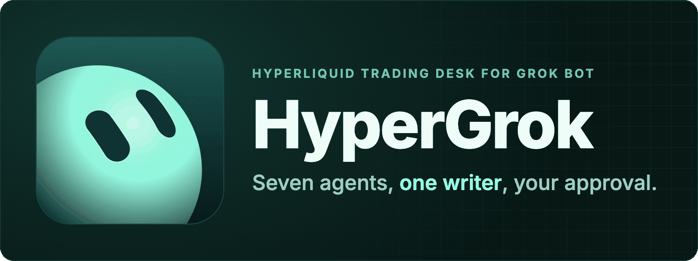
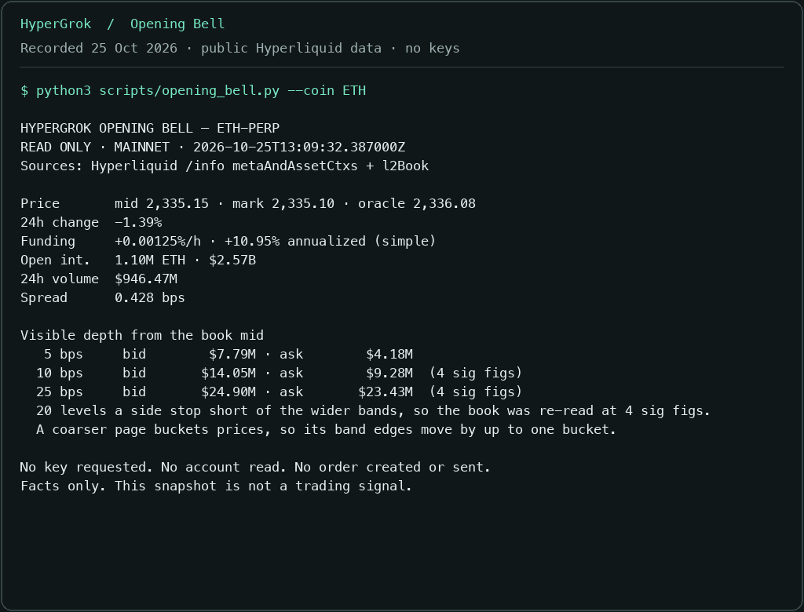
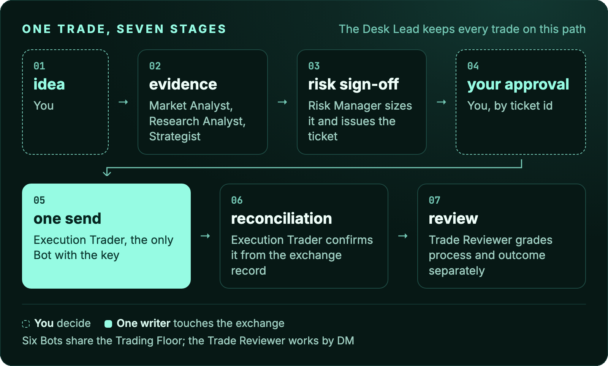

<p align="center">
  
</p>

<p align="center">
  <a href="https://github.com/galleonlabs/hypergrok-trading-desk/releases"></a>
  <a href="https://www.npmjs.com/package/hypergrok-trading-desk"></a>
  <a href="LICENSE"></a>
  <a href="https://www.hypurr.co/ecosystem-projects/hypergrok"></a>
</p>

<p align="center">Works in <a href="#start">Grok Bot</a> · <a href="docs/hyperliquid-claude-code.md">Claude Code</a> · <a href="docs/hyperliquid-cursor.md">Cursor</a> · <a href="docs/hyperliquid-codex.md">Codex</a> · <a href="docs/hyperliquid-gemini-cli.md">Gemini CLI</a> · <a href="docs/hyperliquid-grok-build.md">Grok Build</a></p>

<p align="center"><a href="#try-it-now-no-keys">Try it</a> · <a href="#start">Start</a> · <a href="#meet-the-desk">Meet the desk</a> · <a href="#a-day-on-the-desk">A day on the desk</a> · <a href="#trading-controls">Trading controls</a> · <a href="#inside-the-repository">Docs</a></p>

HyperGrok gives your AI agents a shared process for Hyperliquid research, risk, execution and review. It includes seven role profiles, seventeen skills and read-only Python tools. Start with public market data, then set up the desk in Grok Bot or [your preferred agent tool](#also-runs-in-grok-build-cursor-claude-code-codex-and-gemini-cli). Trading requires your own API wallet, verified approval controls and an exact ticket you approve.

## Try it now, no keys

```bash
git clone --depth 1 --branch v1.7.0 https://github.com/galleonlabs/hypergrok-trading-desk.git
cd hypergrok-trading-desk
python3 scripts/opening_bell.py --coin ETH
```

A live ETH snapshot from Hyperliquid's public `/info` endpoint: price, funding, open interest, spread and depth. It needs no wallet, account or key, and runs on Python 3's standard library.

<p align="center">
  
</p>

Recorded from the command above on 25 October 2026 at 13:09 UTC. The figures are a historical snapshot; run it yourself for current data.

## Start

For the seven-Bot desk with a shared Trading Floor, open Grok Bot and paste:

> Set up the HyperGrok trading desk from https://github.com/galleonlabs/hypergrok-trading-desk/blob/v1.7.0/skills/hypergrok-bootstrap/SKILL.md. Follow the bootstrap skill, use https://github.com/galleonlabs/hypergrok-trading-desk/blob/v1.7.0/SETUP.md for the complete runbook, and finish with its evidence receipt.

Or add the [public HyperGrok Desk Lead template](https://x.ai/bot/qgVMePFoWotJTUtl3gkdZ), then send **Start the desk.** Its 1.7.0 bootstrap installs the complete seventeen-skill release. See the [publication and native content checks](docs/GROK_BOT_TEMPLATE.md#publication-verification---2026-10-25).

The Desk Lead runs Opening Bell, installs the shared skills, prepares the team and returns a setup receipt. The desk starts in research mode. Add a testnet API wallet when you want to practise with play money; mainnet uses the same ticket process after its approval controls are verified. See the [full setup runbook](SETUP.md) for each step.

### Opening Bell

Opening Bell reports source and UTC time, mid/mark/oracle prices, 24-hour change and volume, hourly funding, open interest, spread and depth at 5/10/25 bps. It requests coarser book pages when twenty levels cannot cover a band, identifies each figure's source page and marks unreached depth as a floor. `scripts/desk_doctor.py` checks the release, roles, skill hashes, desk folders and public connectivity. Both use only Python's standard library.

For automation, inspect the offline `--schema`, then use `--json`. Failed reads, partial depth and doctor warnings remain explicit. Snapshots accept canonical mixed-case names and HIP-3 markets:

```bash
python3 scripts/opening_bell.py --schema
python3 scripts/opening_bell.py --coin xyz:TSLA --json
python3 scripts/desk_doctor.py --offline --json
```

`--testnet` explicitly selects testnet. A custom API origin is labelled `custom`. HIP-3 discovery stays read-only; execution remains opt-in under the desk's normal ticket rules.

### History you can check

Before a backtest, collect the exact period into a research bundle:

```bash
python3 scripts/research_dataset.py --coin ETH --interval 4h \
  --start 2026-09-01T00:00:00Z --end 2026-10-01T00:00:00Z \
  --with-funding --output ../hypergrok-data/eth-september --json
python3 scripts/research_dataset.py --verify ../hypergrok-data/eth-september --json
```

The bundle keeps requests, captured responses, observed CSV rows and a hashed manifest. Closed UTC windows, explicit missing ranges and bounded funding pagination distinguish `complete`, `incomplete` and `unavailable` history. Offline verification replays the saved responses; it checks consistency, not source authenticity or strategy quality. The tool needs no key and never fills a gap with synthetic data. See [Research datasets](docs/RESEARCH_DATASETS.md) for the supported intervals, market selection, exit codes and analyst handoff.

## Meet the desk

You supply the ideas. Each role owns a stage and hands its evidence to the next.

| Bot | What they do for you |
| --- | --- |
| **Desk Lead** | Your main contact. Runs the floor, keeps every trade moving through the same clean process. |
| **Market Analyst** | Live Hyperliquid data on demand: price, depth, funding, open interest, candles. Timestamped and sourced. |
| **Research Analyst** | What is happening and what is scheduled: fundamentals, news, catalysts, onchain and social context. |
| **Strategist** | Turns your idea into explicit rules, backtests it honestly on Hyperliquid history, paper-trades it on testnet. |
| **Risk Manager** | Keeps your written limits, sizes every trade from your live account, watches the book, and can say no. |
| **Execution Trader** | The one Bot with the keys. Sends the ticket you approved, once, and reconciles it from the exchange record. |
| **Trade Reviewer** | Keeps the desk journal and grades every trade on process and outcome, separately. |

Six sit together on the **Trading Floor** group chat; the Trade Reviewer works by DM. Every trade follows the same path:

<p align="center">
  
</p>

## A day on the desk

**"Brief me on ETH."** The Market Analyst pulls mid, mark, funding, open interest, 24h volume and depth at 5/10/25 bps from the exchange, and posts a brief with sources and UTC times.

**"I want to long ETH at 3,000 with a stop at 2,900."** In this illustrative example, the Desk Lead opens `HG-20260816-01`. The Risk Manager reads the account and returns a sized ticket:

```
TICKET HG-20260816-01 | mainnet
market ETH-PERP  side buy  size 0.4827 ETH (~$1,448)
entry limit 3,000 Gtc     stop sell 0.4827 @ 2,900 market (sent with the entry)
risk $51.00 = 0.5% of equity $10,200 (clearinghouseState 14:11 UTC)  R = 100
sized on a stressed stop: 100 + 3.00 slippage + 2.65 fees = 105.65 per ETH
approve with: "approve HG-20260816-01"
```

You type `approve HG-20260816-01`. After the pre-send checks and native approval gate pass, the Execution Trader sends entry and stop in one grouped order, reconciles the exchange response and reports the order ids. The Trade Reviewer records costs, process and outcome.

<p align="center">
  
</p>

**"Can we test whether funding extremes mean-revert?"** The Strategist writes the rules with you, collects and verifies the agreed history, then reports costs, funding assumptions, holdout results and the trade distribution. Missing history stays visible. Testnet paper trading follows the same ticket process.

**"Watch ETH and tell me if funding flips negative."** A routine on the desk computer watches the WebSocket feed and pings you when it happens.

## What the desk knows

Seventeen skills, in the portable `SKILL.md` format, shared by all your Bots.

**Bootstrap** - pinned release install, Opening Bell, team construction, desk doctor and a receipt that distinguishes what happened from what still needs a manual step.

**Hyperliquid** - setup and API wallets, market data, account state, orders (limit, IOC, take-profit and stop-loss with grouping, client order ids), positions and margin, WebSocket feeds, advanced actions (dead-man's switch, TWAP, spot), and a compact API reference. Copy-pasteable `curl` for reads; the official Python SDK and `@nktkas/hyperliquid` for anything that signs.

**Desk** - how the team works: operating model, the trade lifecycle and ticket, risk limits and sizing arithmetic, the execution protocol, monitoring and routines, post-trade review, incident playbooks, and the strategy lab.

## Other agent setups

HyperGrok is for a coordinated Hyperliquid desk in Grok Bot. For a different setup, these Galleon projects can help:

- [Boomkin](https://github.com/galleonlabs/boomkin#get-started) sets up a native Hermes DeFi profile with modular skill packs and official tool connections.
- [crypto-defi-skills](https://github.com/galleonlabs/crypto-defi-skills#install-only-what-you-need) lets you add individual workflows to an existing agent: lending, liquidity provision, routing, portfolio review and more.

Neither is required to use HyperGrok. Installing instructions does not connect a wallet or authorize a trade.

## Trading controls

- **You approve every trade**, by ticket id, after seeing the exact order. The line you type is evidence; the gate that enforces it sits outside the chat, in a Grok Bot Auto-review **Ask first** rule, because a Bot that can read an approval could also write one.
- **A trade-only API wallet**, provisioned through Grok Bot's secure secret store, is the only key the desk ever holds. It can trade; it cannot withdraw.
- **Sized on a stressed stop.** The desk includes assumed adverse stop fills and taker fees on both legs when sizing. Actual losses can exceed that assumption. [See what a stop costs](docs/STOP_COST.md).
- **Ceilings you cannot trade through.** Your limits file may only tighten the desk's own caps, never loosen them.
- **Testnet first.** Every new kind of action is rehearsed with play money before it touches mainnet.
- **One writer.** Six Bots read; one Bot sends, once per approval, and reconciles by client order id.
- **Separate process and outcome.** The Trade Reviewer records both in a journal you can read.

Perpetual futures can liquidate an account. HyperGrok is documentation and instructions, not financial advice.

## Also runs in Grok Build, Cursor, Claude Code, Codex and Gemini CLI

Choose the guide for your runtime. Each uses the same skills and ticket process; support for roles, rules and hooks differs.

| Runtime | Setup | Roles and controls |
| --- | --- | --- |
| Claude Code | [Install from the plugin marketplace](docs/hyperliquid-claude-code.md) | Seven subagents and an exchange-write confirmation hook; load the operating model explicitly |
| Cursor | [Open the pinned checkout and enable the plugin](docs/hyperliquid-cursor.md) | Seven role profiles and desk rules; no Claude Code hook |
| Grok Build | [Install the pinned release](docs/hyperliquid-grok-build.md) | Skills and agent directories; rule loading is unverified |
| Codex | [Install from the Codex marketplace](docs/hyperliquid-codex.md) | Skills, with the seven roles run as labelled passes |
| Gemini CLI | [Install the extension](docs/hyperliquid-gemini-cli.md) | Skills and `GEMINI.md`, with roles run as labelled passes |

The Claude Code hook asks for confirmation when a Bash command or a named script looks like an exchange write. It cannot bind a request to a ticket or inspect every imported path. Every runtime still needs verified native approval coverage before an API wallet is provisioned. The guides distinguish manifest support from observed native installation.

The same pack installs as a skill:

```
npm exec --package=skills@1.5.23 -- skills add galleonlabs/hypergrok-trading-desk
```

The complete resources also install from npm:

```bash
npm install --save-exact --ignore-scripts hypergrok-trading-desk@1.7.0
python3 node_modules/hypergrok-trading-desk/scripts/desk_doctor.py --offline
```

The package contains the instructions, role profiles, plugin manifests and read-only Python tools. It has no JavaScript entry point, runtime dependencies or install hooks; installation does not start a desk or connect a wallet.

Live listings: [HypurrCollective ecosystem map](https://www.hypurr.co/ecosystem-projects/hypergrok) · [skills.sh](https://www.skills.sh/galleonlabs/hypergrok-trading-desk) · [cursor.directory](https://cursor.directory/plugins/hypergrok) · [botdirectory.ai](https://botdirectory.ai/bots/hypergrok-trading-desk)

After installation, load `desk-operating-model` using the command or context mechanism in your runtime guide.

## Inside the repository

```
SETUP.md     what your Grok Bot follows to build the desk
agents/      seven roles: Bot profile card + full system prompt
skills/      seventeen skills (bootstrap, hyperliquid-*, desk-*)
template/    exact public Grok Bot profile and skill hashes
scripts/     zero-key market, history and stop-cost reads, offline verification, release checks
docs/        how it works, FAQ, install pages, stop cost, provenance
assets/      the mascot, logo, README graphics and their HTML sources
```

| Doc | |
| --- | --- |
| [How the desk works](docs/ARCHITECTURE.md) | roles, files, trust boundaries |
| [FAQ](docs/FAQ.md) | keys, approvals, testnet, customising the team |
| [Research datasets](docs/RESEARCH_DATASETS.md) | collect, verify and hand off historical evidence |
| [Stop cost](docs/STOP_COST.md) | what a triggered stop costs, from the live book |
| [Skills index](skills/README.md) | every skill and who uses it |
| [Grok Bot template](docs/GROK_BOT_TEMPLATE.md) | public profile, publish contract and clean-install evaluation |
| [Provenance](docs/PROVENANCE.md) | sources and licences |
| [Contributing](CONTRIBUTING.md) · [Security](SECURITY.md) · [Changelog](CHANGELOG.md) | |

## Get help and keep up

- **Updates:** use GitHub's **Watch → Custom → Releases** to follow [new releases](https://github.com/galleonlabs/hypergrok-trading-desk/releases).
- **Setup help:** check the [FAQ](docs/FAQ.md), then ask in [Discussions](https://github.com/galleonlabs/hypergrok-trading-desk/discussions). Share your runtime, release and failing command; keep keys and private account details out.
- **Bugs:** [open an issue](https://github.com/galleonlabs/hypergrok-trading-desk/issues/new/choose) with a reproduction and sanitized output. Follow the [community guidelines](CODE_OF_CONDUCT.md).
- **Contribute:** see [Contributing](CONTRIBUTING.md), the [fork review](docs/FORK_REVIEW.md) and [security policy](SECURITY.md). Share reproducible fixes and source-backed documentation improvements.

## License and credit

[MIT licensed](LICENSE), with the copyright and permission notice retained when reusing copies or substantial portions. Created by [Andrew Wilkinson](https://andrewwilkinson.io) and [Galleon Labs](https://github.com/galleonlabs).

See [reuse and attribution](ATTRIBUTION.md) for a ready-to-copy credit line. If HyperGrok Trading Desk helps your work, [a star on the original repository](https://github.com/galleonlabs/hypergrok-trading-desk) is appreciated and entirely optional.

HyperGrok has no token and will not launch one. [Read the FAQ](docs/FAQ.md#token).
