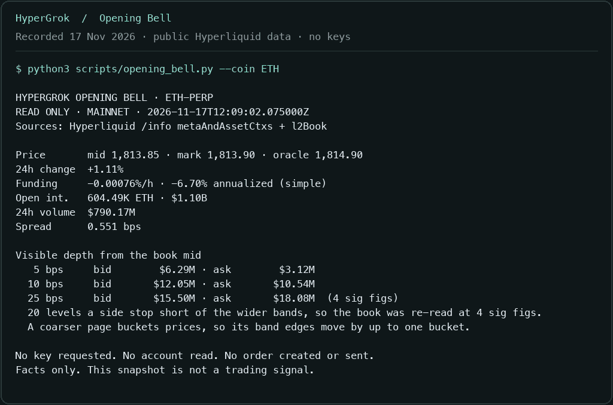

<p align="center">
  <picture>
    <source media="(max-width: 600px)" srcset="assets/hero-mobile.svg">
    
  </picture>
</p>

<p align="center">
  <a href="https://github.com/galleonlabs/hypergrok-trading-desk/releases"></a>
  <a href="https://www.npmjs.com/package/hypergrok-trading-desk"></a>
  <a href="https://github.com/galleonlabs/hypergrok-trading-desk/stargazers"></a>
  <a href="LICENSE"></a>
  <a href="https://www.hypurr.co/ecosystem-projects/hypergrok"></a>
</p>

<p align="center">Works in <a href="#start">Grok Bot</a> · <a href="docs/hyperliquid-claude-code.md">Claude Code</a> · <a href="docs/hyperliquid-cursor.md">Cursor</a> · <a href="docs/hyperliquid-codex.md">Codex</a> · <a href="docs/hyperliquid-gemini-cli.md">Gemini CLI</a> · <a href="docs/hyperliquid-grok-build.md">Grok Build</a></p>

HyperGrok turns your AI agents into a Hyperliquid trading desk. Seven roles take each trade from your idea through evidence, risk sign-off, your approval, one send and review. It starts on public market data with no keys. Trading needs your own trade-only API wallet, and by default every order waits for a ticket you approve.

## Try it now, no keys

```bash
git clone --depth 1 --branch v1.9.0 https://github.com/galleonlabs/hypergrok-trading-desk.git
cd hypergrok-trading-desk
python3 scripts/opening_bell.py --coin ETH
```

A live ETH snapshot from Hyperliquid's public `/info` endpoint: price, funding, open interest, spread and depth. No wallet, account or key; only Python 3's standard library.

<p align="center">
  
</p>

Recorded on 17 November 2026 at 12:09 UTC. Run it yourself for current figures.

## Start

**Grok Bot.** Add the [HyperGrok Desk Lead template](https://x.ai/bot/NNOcKGP7qdJe8o6OmUMpr) and send **Start the desk.** Or paste this into any Bot:

> Set up the HyperGrok trading desk from https://github.com/galleonlabs/hypergrok-trading-desk/blob/v1.9.0/skills/hypergrok-bootstrap/SKILL.md. Follow the bootstrap skill, use https://github.com/galleonlabs/hypergrok-trading-desk/blob/v1.9.0/SETUP.md for the complete runbook, and finish with its evidence receipt.

The Desk Lead rings the Opening Bell, installs the skills, builds the team and returns a receipt of what it verified. Setup is read-only. The desk starts in research mode; add a testnet API wallet to practise with play money, and a mainnet one when you decide to trade. [Setup runbook](SETUP.md) · [template verification](docs/GROK_BOT_TEMPLATE.md)

<a id="other-runtimes"></a>**Other runtimes.** The same skills and ticket process, with the roles and controls each tool supports:

| Runtime | Install | What loads |
| --- | --- | --- |
| Claude Code | [Plugin marketplace](docs/hyperliquid-claude-code.md) | Skills, seven subagents and a backstop hook that asks before likely exchange writes; it cannot see imported helpers or check sizing |
| Cursor | [Pinned checkout and plugin](docs/hyperliquid-cursor.md) | Skills, seven role profiles and the desk rules |
| Codex | [Codex marketplace](docs/hyperliquid-codex.md) | Skills, with roles run as labelled passes |
| Gemini CLI | [Extension](docs/hyperliquid-gemini-cli.md) | Skills and `GEMINI.md`, with roles run as labelled passes |
| Grok Build | [Pinned release](docs/hyperliquid-grok-build.md) | Skills and agent directories; rule loading is unverified |

After installing, load `desk-operating-model` first. Skills alone do not enforce exchange permissions: verify your runtime's own approval control covers exchange writes before you provision a key.

<details>
<summary><strong>Skills-only and npm installs</strong></summary>

As portable skills:

```
npm exec --package=skills@1.5.23 -- skills add galleonlabs/hypergrok-trading-desk
```

As an npm resource package:

```bash
npm install --save-exact --ignore-scripts hypergrok-trading-desk@1.9.0
python3 node_modules/hypergrok-trading-desk/scripts/desk_doctor.py --offline
```

The package holds the instructions, role profiles, plugin manifests and Python tools. It has no JavaScript entry point, dependencies or install hooks, and installing it does not start a desk or connect a wallet.

</details>

## Meet the desk

You bring the ideas. Each role owns one stage and hands its evidence to the next.

| Role | What it does for you |
| --- | --- |
| **Desk Lead** | Your main contact. Routes work and keeps every trade on the same path. |
| **Market Analyst** | Live Hyperliquid data: price, depth, funding, open interest, candles. Timestamped and sourced. |
| **Research Analyst** | Fundamentals, news, catalysts, onchain and social context. |
| **Strategist** | Turns your idea into explicit rules, backtests it on Hyperliquid history and paper-trades it on testnet. |
| **Risk Manager** | Keeps your written limits, sizes every trade from your live account, and can say no. |
| **Execution Trader** | The one role with the keys. Sends the approved ticket once and reconciles it from the exchange record. |
| **Trade Reviewer** | Keeps the journal and grades process and outcome separately. |

In Grok Bot, six sit on the **Trading Floor** group chat and the Trade Reviewer works by DM.

<p align="center">
  <picture>
    <source media="(max-width: 600px)" srcset="assets/desk-flow-mobile.svg">
    
  </picture>
</p>

## A day on the desk

**"Brief me on ETH."** The Market Analyst posts price, funding, open interest, volume and depth from the exchange, with sources and UTC times.

**"I want to long ETH at 3,000 with a stop at 2,900."** The Desk Lead opens a proposal. The Risk Manager reads the account and returns a sized ticket (illustrative figures):

```
TICKET HG-20260816-01 | mainnet
market ETH-PERP  side buy  size 0.4827 ETH (~$1,448)
entry limit 3,000 Gtc     stop sell 0.4827 @ 2,900 market (sent with the entry)
risk $51.00 = 0.5% of equity $10,200 (clearinghouseState 14:11 UTC)  R = 100
sized on a stressed stop: 100 + 3.00 slippage + 2.65 fees = 105.65 per ETH
approve with: "approve HG-20260816-01"
```

You type `approve HG-20260816-01`. Once the pre-send checks and your runtime's approval gate pass, the Execution Trader sends entry and stop as one grouped order, reconciles the exchange response and reports the order ids. The Trade Reviewer records costs, process and outcome.

<p align="center">
  
</p>

**"Can we test whether funding extremes mean-revert?"** The Strategist writes the rules with you, collects and verifies the history, then reports costs, funding assumptions, holdout results and the trade distribution. Missing history stays visible.

**"Watch ETH and tell me if funding flips negative."** A routine watches the WebSocket feed and pings you when it happens.

## Trading controls

- **You approve each trade**, by ticket id, after seeing the exact order. The gate that enforces it sits outside the chat (in Grok Bot, an Auto-review **Ask first** rule), because a Bot that can read an approval could also write one.
- **A trade-only API wallet** is the only key the desk holds, kept in your runtime's secret store. It can trade; it cannot withdraw.
- **One writer.** Six roles read; one sends, once per approval, and reconciles by client order id.
- **Sized on a stressed stop.** Sizing includes assumed stop slippage and taker fees on both legs. Actual losses can exceed that assumption. [What a stop costs](docs/STOP_COST.md)
- **Ceilings you cannot trade through.** Your limits file can tighten the desk's caps, never loosen them.
- **Testnet first.** Each new kind of action is rehearsed with play money before mainnet.
- **Process and outcome graded separately**, in a journal you can read.

**Opt-in automation.** In Claude Code only, you can write a [standing mandate](docs/STANDING_MANDATE.md): your own markets, limits and daily loss stop. Orders inside it go out without asking. Its limits are yours and may exceed the default ceilings, and testnet rehearsal becomes your call. Each order still needs a Risk PASS, a resting stop and a journal entry. The desk never writes or widens a mandate, and one line revokes it.

Perpetual futures can liquidate an account. HyperGrok is documentation and instructions, not financial advice.

## Tools

Six read-only Python tools ship with the desk. Each uses only the standard library, needs no key, signs nothing, and offers `--schema` and `--json` for scripts. Network reads go to Hyperliquid's public `/info` endpoint.

| Tool | What it answers |
| --- | --- |
| [`opening_bell.py`](scripts/opening_bell.py) | What is this market doing now? Prices, funding, open interest, spread and depth at 5/10/25 bps, including HIP-3 markets such as `xyz:TSLA`. |
| [`stop_cost.py`](docs/STOP_COST.md) | What does my stop really cost? Sizes one trade on the drawn and the stressed stop from the live book. |
| [`account_read.py`](docs/ACCOUNT_READ.md) | What does this account hold? Positions and equity across the main DEX, every HIP-3 DEX and spot. |
| [`research_dataset.py`](docs/RESEARCH_DATASETS.md) | Is my backtest history complete? Collects candles and funding into a hashed bundle and replays it offline. |
| [`desk_doctor.py`](scripts/desk_doctor.py) | Is my install intact? Checks the release, roles, skill hashes, desk folders and public connectivity. |
| [`standing_mandate.py`](docs/STANDING_MANDATE.md) | Is the mandate I wrote valid? An offline check of every field. |

## Docs

| | |
| --- | --- |
| [How the desk works](docs/ARCHITECTURE.md) | Roles, files and trust boundaries |
| [FAQ](docs/FAQ.md) | Keys, approvals, testnet, customising the team |
| [Skills index](skills/README.md) | All seventeen skills and who uses them |
| [Setup runbook](SETUP.md) | What a Grok Bot follows to build the desk |
| [Grok Bot template](docs/GROK_BOT_TEMPLATE.md) | Public profile and publication checks |
| [Provenance](docs/PROVENANCE.md) | Sources, SDK versions and licences |
| [Changelog](CHANGELOG.md) · [Contributing](CONTRIBUTING.md) · [Security](SECURITY.md) | |

Listed on the [HypurrCollective ecosystem map](https://www.hypurr.co/ecosystem-projects/hypergrok), [skills.sh](https://www.skills.sh/galleonlabs/hypergrok-trading-desk), [cursor.directory](https://cursor.directory/plugins/hypergrok) and [botdirectory.ai](https://botdirectory.ai/bots/hypergrok-trading-desk).

## Help and updates

- **Releases:** GitHub **Watch → Custom → Releases**, or the [release page](https://github.com/galleonlabs/hypergrok-trading-desk/releases).
- **Setup help:** the [FAQ](docs/FAQ.md), then [Discussions](https://github.com/galleonlabs/hypergrok-trading-desk/discussions). Share your runtime, release and failing command; keep keys and account details out.
- **Bugs:** [open an issue](https://github.com/galleonlabs/hypergrok-trading-desk/issues/new/choose) with a reproduction and sanitized output.
- **Contributing:** [CONTRIBUTING.md](CONTRIBUTING.md), the [fork review](docs/FORK_REVIEW.md) and the [community guidelines](CODE_OF_CONDUCT.md).

## What HyperGrok is not

There is no HyperGrok token and there will not be one. There is no `hypergrok` command-line binary, no bundled strategy or signal, and no profit claim. Posts showing otherwise are not from this project. [FAQ](docs/FAQ.md#what-it-is-not)

## License and credit

[MIT](LICENSE). Created by [Andrew Wilkinson](https://andrewwilkinson.io) and [Galleon Labs](https://github.com/galleonlabs). Keep the copyright and permission notice when you reuse it; [ATTRIBUTION.md](ATTRIBUTION.md) has a ready-to-copy credit line. A [star](https://github.com/galleonlabs/hypergrok-trading-desk) is appreciated and optional.

Also from Galleon Labs: [Boomkin](https://github.com/galleonlabs/boomkin#get-started), a Hermes DeFi profile with modular skill packs, and [crypto-defi-skills](https://github.com/galleonlabs/crypto-defi-skills#install-only-what-you-need), individual DeFi workflows for an existing agent.
